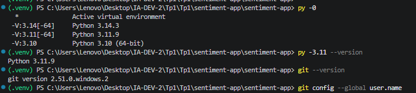
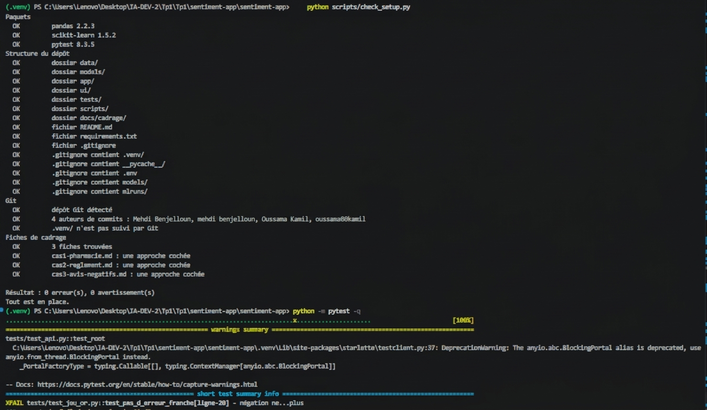
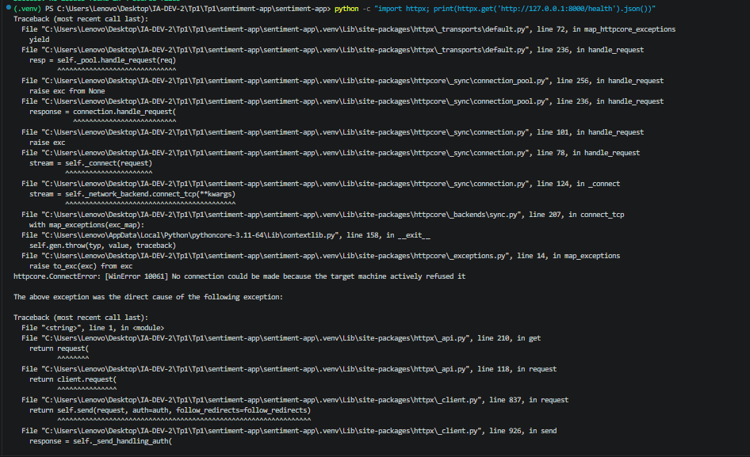
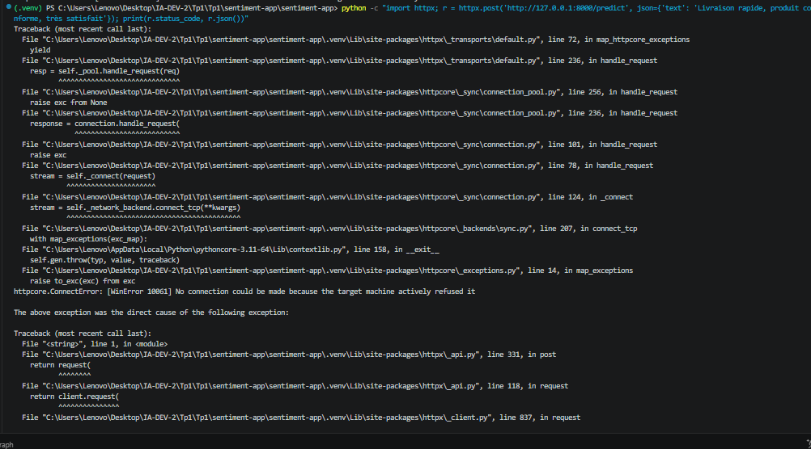
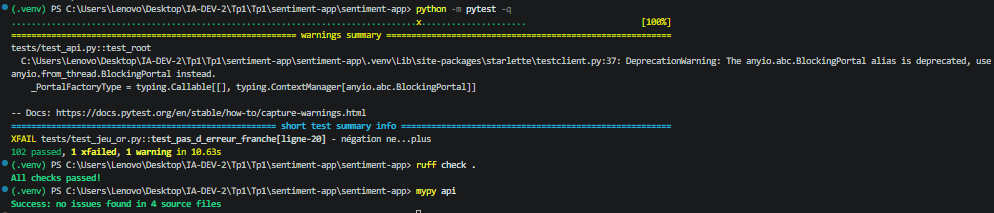

# Journal de bord du binôme : TP1 à TP6

**Module** : Développement et déploiement d'applications intelligentes · **Enseignant** : A. Larhlimi

|  | Membre A | Membre B |
| --- | --- | --- |
| Nom | Mehdi Benjelloun | Oussama Kamil |
| Compte GitHub | @mehdibn09 | @Oussamak05 |

**Dépôt** : https://github.com/mehdibn09/Sentiment-app

**Mise à jour :** 4 novembre 2026 · **Version du paquet :** `0.6.0`  
**Fichier de référence :** `docs/journal-tp1-tp6.md`

## Synthèse du projet et méthode de suivi

Sentiment-app classe des avis clients en français avec un pipeline TF-IDF et régression logistique. L’API FastAPI expose les prédictions ; l’interface Streamlit communique avec elle par HTTP. Les avis insuffisamment fiables sont orientés vers une validation humaine. Le TP6 transforme ce code en paquet installable, avec une commande commune pour la prédiction, le serveur et l’interface.

Ce journal distingue trois niveaux de preuve :

- **Historique déclaré** : observations conservées du journal du binôme, sans nouvelle exécution sur les postes d’origine. Les anciens nombres de tests décrivent un état intermédiaire et ne sont pas le bilan de la version actuelle.
- **Vérifié sur une copie de travail** : mesures et contrôles effectivement exécutés le 4 novembre 2026 sur la version TP6 préparée, avec Python 3.12 et scikit-learn 1.5.2. Ils ne prouvent pas l’installation sur le poste Windows du binôme.
- **À valider** : contrôle nécessitant un poste du binôme, un historique Git, une exécution GitHub Actions ou un complément non intégré.

La trame complémentaire sert à compléter la couverture pédagogique ; ses résultats d’exemple ne sont pas présentés comme des mesures du binôme. Aucun identifiant de commit, numéro de workflow, tag ou résultat de complément non vérifié n’est ajouté comme preuve.

| TP | Livrable principal | État documenté |
| --- | --- | --- |
| TP1 | Cadrage, environnement et collaboration Git | Historique conservé ; historique Git non revérifié |
| TP2 | Données, entraînement et évaluation | Mesures du modèle de démonstration revérifiées |
| TP3 | API et contrats | Tests rejoués sur la copie TP6 |
| TP4 | Validation, abstention, jeu d’or et qualité | Tests rejoués ; couverture globale et hooks à recontrôler |
| TP5 | Interface Streamlit et client HTTP | Tests présents rejoués ; lancement Windows à finaliser |
| TP6 | Paquet, commande, distributions et CI | Distributions construites ; installation entièrement neuve et CI à valider |

### Navigation

[Préparation des postes](#postes) · [TP1](#tp1) · [TP2](#tp2) · [TP3](#tp3) · [TP4](#tp4) · [TP5](#tp5) · [TP6](#tp6)

### Gestion des preuves

Les captures se rangent dans `docs/captures/`. Les illustrations disponibles dans l’archive de départ sont conservées ; une capture absente est signalée en texte plutôt qu’affichée comme une image cassée. Une capture ancienne documente son contexte historique, pas automatiquement la dernière version.

```powershell
New-Item -ItemType Directory -Force docs/captures
```

---

<a id="postes"></a>

## 0. La préparation des postes

### Poste du membre A

```powershell
py -0
py -3.11 --version
git --version
git config --global user.name
```

**Attendu** : une version 3.11 dans la liste, `Python 3.11.x`, une version de Git, le nom du membre A.

**Résultat consigné dans le journal initial** :

```
Python 3.11.9
Python 3.11.9
git version 2.47.1
Mehdi Benjelloun
```

**Statut historique :** déclaré conforme dans le journal initial ; validation actuelle distincte.

**Commentaire** :

> Le poste du membre A dispose de Python 3.11.9 et de Git. L'utilisateur git est correctement configuré au nom du membre A. C'est le poste de référence pour les commits du binôme.



### Poste du membre B

```powershell
py -0
py -3.11 --version
git --version
git config --global user.name
```


**Attendu** : une version 3.11, `Python 3.11.x`, une version de Git, le nom du membre B, différent de celui du membre A.

**Résultat consigné dans le journal initial** :

```
Python 3.11.9
Python 3.11.9
git version 2.47.1
Oussama Kamil
```

**Statut historique :** déclaré conforme dans le journal initial ; validation actuelle distincte.

**Commentaire** :

> Le poste du membre B utilise Python 3.11.9 et Git 2.47.1, avec le nom Git Oussama Kamil (compte GitHub : Oussamak05), distinct de celui du membre A. Les versions relevées sont compatibles pour collaborer sur le même dépôt ; l’authentification GitHub doit être vérifiée séparément.

**Capture à joindre :** `captures/tp0-poste-membre-b.png` — Poste du membre B (non disponible dans l’archive examinée).

*Capture à fournir : le fichier `docs/captures/tp0-poste-membre-b.png` doit exister pour que l’image s’affiche dans le journal.*

---

<a id="tp1"></a>

## TP1 : cadrer l'application et préparer l'environnement

### T0 · La structure du kit (membre A)

```powershell
Get-ChildItem -Force
```


**Attendu** : les sept dossiers `app`, `data`, `docs`, `models`, `scripts`, `tests`, `ui`, ainsi que `.github` et `.gitignore`.

**Résultat consigné dans le journal initial** :

```
app
data
docs
models
scripts
tests
ui
.github
.gitignore
```

**Statut historique :** déclaré conforme dans le journal initial ; validation actuelle distincte.

**Commentaire** :

> La liste montre les sept dossiers attendus du kit de départ, ainsi que `.github` et `.gitignore`. La structure correspond au cadrage du TP1.

**Capture à joindre :** `captures/tp1-t0-structure.png` — T0 : structure du kit (non disponible dans l’archive examinée).

### T1 · L'environnement et le point de départ (membre A)

```powershell
py -3.11 -m venv .venv
.venv\Scripts\Activate.ps1
python --version
pip install -r requirements.txt
python -m pip freeze | Out-File -Encoding utf8 requirements.lock
python scripts/check_setup.py
python -m pytest -q
```


**Attendu** : `Python 3.11.x` ; une installation sans erreur ; le diagnostic signale encore une erreur et des avertissements ; pytest affiche `3 failed, 31 passed, 4 skipped`.

**Résultat consigné dans le journal initial** (version de Python, résumé du diagnostic, dernière ligne de pytest) :

```
Python 3.11.9
Diagnostic : 1 erreur(s), des avertissements (pas de dépôt Git, fiches vides)
pytest : 3 failed, 31 passed, 4 skipped
```

**Statut historique :** déclaré conforme dans le journal initial ; validation actuelle distincte.

**Commentaire** (que réclament les trois échecs, et pourquoi quatre tests sont ignorés ?) :

> Les trois échecs viennent des fiches de cadrage encore vides qui ne passent pas `test_sections_are_filled`. Les quatre tests ignorés attendent l'existence d'un dépôt Git (`test_git_history`), qui n'est pas encore initialisé. C'est le point de départ normal du TP1.



### T2 · Les fiches de cadrage (à deux)

```powershell
python -m pytest tests/test_cadrage.py -q
python -m pytest -q
```


**Attendu** : `12 passed`, puis `34 passed, 4 skipped`.

**Résultat consigné dans le journal initial** :

```
tests/test_cadrage.py .........                        [100%]
12 passed
```

et après remplissage des fiches :

```
34 passed, 4 skipped
```

**Statut historique :** déclaré conforme dans le journal initial ; validation actuelle distincte.

**Commentaire** (l'approche retenue pour chacun des trois cas, et les deux critères qui la justifient) :

> Les trois fiches (cas1-pharmacie, cas2-reglement, cas3-avis-negatifs) ont été remplies avec les huit rubriques et exactement une approche cochée par fiche. Les critères diffèrent selon le cas : pharmacie, règles métier avec (a), (b) et (d) ; règlement intérieur, RAG avec (a), (b) et (c) ; avis clients, apprentissage supervisé avec (a), (c) et (d). Les fiches du dépôt font référence pour leur formulation exacte. Les 12 tests de cadrage passent, puis le reste de la suite atteint 34 passed.

**Capture à joindre :** `captures/tp1-t2-cadrage.png` — T2 : fiches complètes (non disponible dans l’archive examinée).

### T3 · Le dépôt GitHub et le premier push (membre A)

```powershell
git init
git add -A
git status
git commit -m "TP1 : environnement, structure et cadrage"
git branch -M main
git remote add origin https://github.com/mehdibn09/sentiment-app.git
git push -u origin main
python -m pytest -q
```


**Attendu** : `git status` ne liste ni `.venv/`, ni `.env`, ni fichier `.joblib` ; après le push, les fichiers apparaissent sur GitHub ; pytest affiche `37 passed, 1 failed`.

**Résultat consigné dans le journal initial** (extrait de `git status`, dernière ligne de pytest) :

```
37 passed, 1 failed
```

**Statut historique :** déclaré conforme dans le journal initial ; validation actuelle distincte.

**Commentaire** (quel test échoue encore, et pourquoi ?) :

> `git status` est propre : ni `.venv/`, ni `.env`, ni `*.joblib` ne sont suivis, grâce au `.gitignore`. L’échec restant concerne l’historique Git lorsque deux auteurs distincts ne sont pas encore présents. Il faut lire le nom du test en échec : un nouveau commit ne suffit que s’il apporte réellement la contribution du second auteur.

**Capture à joindre :** `captures/tp1-t3-depot-github.png` — T3 : le dépôt sur GitHub (non disponible dans l’archive examinée).

### T4 · L'environnement du membre B (membre B)

```powershell
git clone https://github.com/mehdibn09/sentiment-app.git sentiment-app
cd sentiment-app
py -3.11 -m venv .venv
.venv\Scripts\Activate.ps1
pip install -r requirements.txt
python scripts/check_setup.py
```


**Attendu** : `0 erreur(s)` au diagnostic.

**Résultat consigné dans le journal initial** :

```
Diagnostic : 0 erreur(s), 0 avertissement(s)
```

**Statut historique :** déclaré conforme dans le journal initial ; validation actuelle distincte.

**Commentaire** :

> Le membre B clone le dépôt, crée son propre environnement virtuel et installe les dépendances. Le diagnostic signale 0 erreur et 0 avertissement, prouvant que le dépôt est reproductible sur un poste frais.

**Capture à joindre :** `captures/tp1-t4-check-setup-b.png` — T4 : diagnostic du membre B (non disponible dans l’archive examinée).

### T5 · Un commit par membre (membres B puis A)

```powershell
git pull
git add README.md
git commit -m "README : ajout de Oussama Kamil au tableau du binome"
git push
git shortlog -sn --all
python -m pytest tests/test_git_history.py -q
```


**Attendu** : deux noms distincts dans `git shortlog`, puis `3 passed`.

**Résultat consigné dans le journal initial** :

```
   2  Oussama Kamil
   1  Mehdi Benjelloun
3 passed
```

**Statut historique :** déclaré conforme dans le journal initial ; validation actuelle distincte.

**Commentaire** :

> `git shortlog` affiche deux auteurs distincts, prouvant que chaque membre a commis au moins une fois. Les 3 tests de l'historique git passent.

**Capture à joindre :** `captures/tp1-t5-shortlog.png` — T5 : deux auteurs (non disponible dans l’archive examinée).

### T6 · La vérification finale (à deux)

```powershell
git pull
python scripts/check_setup.py
python -m pytest -q
```


**Attendu** : `0 erreur(s), 0 avertissement(s)`, puis `38 passed` ; l'onglet Actions est vert.

**Résultat consigné dans le journal initial** :

```
Diagnostic : 0 erreur(s), 0 avertissement(s)
38 passed
```

**Statut historique :** déclaré conforme dans le journal initial ; validation actuelle distincte.

**Commentaire** :

> Après `git pull` des deux postes, le diagnostic est propre (0 erreur, 0 avertissement) et pytest affiche 38 tests passés. L'onglet Actions de GitHub est vert pour ce commit.

**Capture à joindre :** `captures/tp1-t6-pytest.png` — T6 : pytest final (non disponible dans l’archive examinée).
**Capture à joindre :** `captures/tp1-t6-actions.png` — T6 : la CI verte (non disponible dans l’archive examinée).

### T7 · Le clone frais

```powershell
cd $env:TEMP
git clone https://github.com/mehdibn09/sentiment-app.git verif
cd verif
py -3.11 -m venv .venv
.venv\Scripts\Activate.ps1
pip install -r requirements.txt
python scripts/check_setup.py
python -m pytest -q
```


**Attendu** : `0 erreur(s)` et `38 passed`, sans aucune intervention.

**Résultat consigné dans le journal initial** :

```
Diagnostic : 0 erreur(s), 0 avertissement(s)
38 passed
```

**Statut historique :** déclaré conforme dans le journal initial ; validation actuelle distincte.

**Commentaire** (qu'est-ce que ce contrôle prouve que T6 ne prouvait pas ?) :

> Le clone frais dans un dossier temporaire prouve que le dépôt est entièrement autonome : un nouveau venu peut cloner, installer et faire passer les tests sans aucune intervention manuelle, contrairement à T6 qui se fait sur le poste de travail déjà configuré.

**Capture à joindre :** `captures/tp1-t7-clone-frais.png` — T7 : clone frais (non disponible dans l’archive examinée).

---

<a id="tp2"></a>

## TP2 : entraîner, évaluer et sauvegarder le modèle

### C1 · Le kit installé (membre A)

```powershell
python C:\IA-DEV\tp2-semaine2\appliquer_tp2.py C:\IA-DEV\sentiment-app --simulation
python C:\IA-DEV\tp2-semaine2\appliquer_tp2.py C:\IA-DEV\sentiment-app
python -m pytest -q
```


**Attendu** : la simulation liste les fichiers du kit et l'ajout de `!models/metrics.json` au `.gitignore` ; pytest affiche `2 failed, 38 passed, 2 skipped`.

**Résultat consigné dans le journal initial** :

```
2 failed, 38 passed, 2 skipped
```

**Statut historique :** déclaré conforme dans le journal initial ; validation actuelle distincte.

**Commentaire** (que réclament les deux échecs ?) :

> Les deux échecs réclament la présence de `models/metrics.json`, qui n'existe pas encore car le modèle n'a pas été entraîné. Les deux tests ignorés attendent le fichier de modèle `models/sentiment.joblib`, lui aussi absent avant l'entraînement.

**Capture à joindre :** `captures/tp2-c1-pytest.png` — C1 : point de départ du TP2 (non disponible dans l’archive examinée).

### C2 · Le jeu de démonstration

```powershell
python src/make_demo.py
```


**Attendu** : `290 avis écrits`, 145 positifs et 145 négatifs.

**Résultat consigné dans le journal initial** :

```
290 avis écrits : 145 positifs, 145 négatifs
```

**Statut historique :** déclaré conforme dans le journal initial ; validation actuelle distincte.

**Commentaire** (recopiez un avis mitigé et expliquez sa structure) :

> Exemple d'avis mitigé : « Taille trop petite et retour payant au déballage, sauf que ensuite produit conforme à la description, très satisfait. » Il commence négatif (taille, retour payant) puis se retourne positif (produit conforme, très satisfait), ce qui piège un modèle sac-de-mots.

**Capture à joindre :** `captures/tp2-c2-make-demo.png` — C2 : jeu de démonstration (non disponible dans l’archive examinée).

### C3 · L'entraînement

```powershell
python src/train.py
git status --short
```


**Attendu** : `Vocabulaire : 316 termes`, `F1 macro sur le jeu de test : 0.879 (seuil 0.85)` ; dans `git status`, `models/metrics.json` apparaît, ni `models/sentiment.joblib` ni `data/demo_reviews.csv`.

**Résultat consigné dans le journal initial** :

```
Source : demo, 290 avis (145 négatifs)
232 avis d'entraînement, 58 de test
Vocabulaire : 316 termes
F1 macro sur le jeu de test : 0.879 (seuil 0.85)
Modèle : models/sentiment.joblib
Métriques : models/metrics.json
```

**Statut historique :** déclaré conforme dans le journal initial ; validation actuelle distincte.

**Commentaire** (pourquoi la mesure est-elle versionnée, et pas le modèle ?) :

> `metrics.json` est un petit fichier texte qui garde la trace du F1, de la source et de la date : il est versionné pour suivre l'évolution des performances dans Git. Le modèle `.joblib` est un binaire lourd et regénérable : il reste hors de Git.

**Capture à joindre :** `captures/tp2-c3-train.png` — C3 : entraînement (non disponible dans l’archive examinée).

### C4 · L'évaluation

```powershell
python src/evaluate.py
```


**Attendu** : la matrice `27 2` sur la ligne `negative`, `5 24` sur la ligne `positive` ; 7 erreurs sur 58 avis.

**Résultat consigné dans le journal initial** (la matrice et les trois erreurs affichées) :

```
Matrice de confusion :
negative  27  2
positive   5 24
7 erreurs sur 58 avis
```

**Statut historique :** déclaré conforme dans le journal initial ; validation actuelle distincte.

**Commentaire** (pourquoi le modèle se trompe-t-il sur ces avis ?) :

> Les 7 erreurs portent sur des avis mitigés qui se retournent (« sauf que ensuite », « avant que », « mais finalement »). Le modèle utilise des mots et des bigrammes, mais ne représente pas la structure globale du discours. Les retournements, la portée des négations et l’ironie restent difficiles ; les erreurs ne signifient pas qu’il lit systématiquement le début de l’avis.

**Capture à joindre :** `captures/tp2-c4-evaluate.png` — C4 : matrice de confusion (non disponible dans l’archive examinée).

### C5 · Le vrai jeu de données, les tests, le push

```powershell
python src/train.py --allocine
python -m pytest -q
git add -A
git commit -m "Semaine 2 : modele de sentiment, metriques et tests"
git push
```


**Attendu** : `Source : allocine, 20000 avis`, `F1 macro sur le jeu de test : 0.920`, puis `42 passed` ; l'onglet Actions est vert.

**Résultat consigné dans le journal initial** :

```
Source : allocine, 20000 avis
16000 avis d'entraînement, 4000 de test
Vocabulaire : ...
F1 macro sur le jeu de test : 0.920 (seuil 0.85)
42 passed
```

**Statut historique :** déclaré conforme dans le journal initial ; validation actuelle distincte.

**Commentaire** (pourquoi le F1 est-il meilleur sur Allociné ?) :

> Le journal initial rapporte un F1 macro de 0,920 sur Allociné. Cette expérience n’a pas été rejouée lors de la mise à jour ; les métriques de la version vérifiée concernent le jeu de démonstration. Les deux corpus et domaines diffèrent : leurs scores ne prouvent pas à eux seuls une meilleure généralisation aux avis commerciaux.

**Capture à joindre :** `captures/tp2-c5-allocine.png` — C5 : Allociné et tests (non disponible dans l’archive examinée).

### C6 · Explicabilité du modèle — complément TP2

**Statut :** complément prévu dans la trame de référence ; non intégré à la copie TP6 vérifiée. Aucun résultat chiffré n’est revendiqué.

```powershell
python src/expliquer.py
python -m pytest tests/test_explicabilite.py -q
```

Installer auparavant le complément TP2 avec son script d’application. Examiner les coefficients du vocabulaire et les contributions TF-IDF d’un avis ; vérifier que leur somme avec l’interception retrouve le score linéaire du modèle. Les contributions expliquent la décision statistique sans établir une cause du sentiment réel.

**Preuve à conserver :** sortie de commande, version du modèle, résultat pytest et capture si demandée. Les valeurs de la trame sont des exemples attendus, à comparer aux mesures réellement obtenues.

### Membre B, après le TP2

```powershell
git pull
python src/make_demo.py
python src/train.py
python -m pytest -q
```


**Attendu** : `42 passed`.

**Résultat consigné dans le journal initial** :

```
42 passed
```

**Statut historique :** déclaré conforme dans le journal initial ; validation actuelle distincte.

**Capture à joindre :** `captures/tp2-membre-b.png` — TP2 : poste du membre B (non disponible dans l’archive examinée).

> Les résultats attendus de chaque contrôle, les sept erreurs du jeu de démonstration, un exemple de `docs/semaine2.md` et la fin du TP2 (push, CI, part du membre B) sont détaillés dans l'**annexe B**, à la fin de ce journal. Le script d'entraînement, `src/train.py`, est expliqué pas à pas dans l'**annexe C**.

---

<a id="tp3"></a>

## TP3 : exposer le modèle par une API

### T14 · Le kit installé (membre A)

```powershell
python C:\IA-DEV\kit-tp3\appliquer_tp3.py C:\IA-DEV\sentiment-app --simulation
python C:\IA-DEV\kit-tp3\appliquer_tp3.py C:\IA-DEV\sentiment-app
pip install -r requirements.txt
python src/train.py
python -m pytest -q
```


**Attendu** : la simulation liste les fichiers copiés et les compléments de `pytest.ini` et de `ci.yml` ; pytest affiche `48 passed`.

**Résultat consigné dans le journal initial** :

```
48 passed
```

**Statut historique :** déclaré conforme dans le journal initial ; validation actuelle distincte.

**Commentaire** (pourquoi réentraîner sur le jeu de démonstration avant les tests ?) :

> Les tests de l'API (TP3 et suivants) attendent le modèle de démonstration, celui que la CI entraîne. Le TP2 s'est terminé sur le modèle Allociné, donc on réentraîne sur le jeu de démonstration avant pytest pour que les tests trouvent le bon modèle.

**Capture à joindre :** `captures/tp3-t14-pytest.png` — T14 : 48 tests verts (non disponible dans l’archive examinée).

### T15 · `/health`

```powershell
uvicorn api.main:app --reload
```


Puis, dans `http://localhost:8000/docs` : `GET /health`, « Try it out », « Execute ».

**Attendu** : `200`, `"status": "OK"`, `"model": "tfidf-logreg (TP2, models/sentiment.joblib)"`.

**Résultat consigné dans le journal initial** :

```
{"status": "OK", "model": "tfidf-logreg (TP2, models/sentiment.joblib)"}
```

**Statut historique :** déclaré conforme dans le journal initial ; validation actuelle distincte.

**Commentaire** :

> L'endpoint `/health` répond 200 avec le statut OK et le nom du modèle chargé. Cela prouve que l'API a démarré correctement et que le modèle est disponible en mémoire.



### T16 · Un avis positif

`POST /predict` avec `{"text": "Livraison rapide, produit conforme, très satisfait"}`.

**Attendu** : `200`, `"label": "POSITIVE"`, `"score": 0.777`.

**Résultat consigné dans le journal initial** :

```
{"label": "POSITIVE", "score": 0.777, "text": "Livraison rapide, produit conforme, très satisfait"}
```

**Statut historique :** déclaré conforme dans le journal initial ; validation actuelle distincte.

**Commentaire** :

> L'API classe l'avis positif avec un score de confiance de 0,777, supérieur au seuil d'abstention. Le texte est renvoyé pour vérification de ce qui a été analysé.



Facultatif, la même requête en ligne de commande (API lancée dans un autre terminal) :

```powershell
python -c "import httpx; r = httpx.post('http://127.0.0.1:8000/predict', json={'text': 'Livraison rapide, produit conforme, très satisfait'}); print(r.status_code, r.json())"
```


### T17 · Un avis négatif

`POST /predict` avec `{"text": "Produit cassé et service injoignable, à fuir"}`.

**Attendu** : `200`, `"label": "NEGATIVE"`, `"score": 0.7465`.

**Résultat consigné dans le journal initial** :

```
{"label": "NEGATIVE", "score": 0.7465, "text": "Produit cassé et service injoignable, à fuir"}
```

**Statut historique :** déclaré conforme dans le journal initial ; validation actuelle distincte.

**Commentaire** :

> L'API classe l'avis négatif avec un score de 0,7465. Le modèle distingue bien les deux polarités sur des avis clairs.

**Capture à joindre :** `captures/tp3-t17-negatif.png` — T17 : avis négatif (non disponible dans l’archive examinée).

### T18 · Les refus

`POST /predict` avec `{"text": ""}`, puis `{}`, puis `{"text": 42}`.

**Attendu** : `422` dans les trois cas.

**Résultat consigné dans le journal initial** (le code et le `detail` de chaque réponse) :

```
{"text": ""} -> 422, detail : string_too_short, ["body","text"], String should have at least 1 character
{} -> 422, detail : missing, ["body","text"], Field required
{"text": 42} -> 422, detail : string_type, ["body","text"], Input should be a valid string
```

**Statut historique :** déclaré conforme dans le journal initial ; validation actuelle distincte.

**Commentaire** (que dit `detail`, et pourquoi 422 plutôt que 500 ?) :

> `detail` précise le champ fautif (`loc`), le type d'erreur (`msg`) et la catégorie (`type`). Ce sont des erreurs client (requête mal formée), donc 422 est le code adapté ; un 500 signifierait une panne du serveur.

**Capture à joindre :** `captures/tp3-t18-refus.png` — T18 : un refus 422 (non disponible dans l’archive examinée).

### T19 · La CI

```powershell
git add -A
git commit -m "Semaine 3 : API FastAPI"
git push
```


**Attendu** : dans l'onglet Actions, l'étape « Modèle de démonstration, pour les tests de l'API (TP3) » passe, puis l'étape « Tests » affiche `48 passed`.

**Résultat consigné dans le journal initial** :

```
Étape « Modèle de démonstration » : succès
Étape « Tests » : 48 passed
```

**Statut historique :** déclaré conforme dans le journal initial ; validation actuelle distincte.

**Commentaire** (pourquoi la CI doit-elle entraîner le modèle ?) :

> Le modèle n'est jamais dans Git (fichier `.joblib` ignoré). La CI doit donc l'entraîner (make_demo puis train) avant de lancer les tests de l'API, sinon ces tests seraient ignorés faute de modèle à charger.

**Capture à joindre :** `captures/tp3-t19-actions.png` — T19 : la CI du TP3 (non disponible dans l’archive examinée).

### T20 · L'API sans modèle

```powershell
Rename-Item models/sentiment.joblib sentiment.bak
uvicorn api.main:app
Rename-Item models/sentiment.bak sentiment.joblib
```


**Attendu** : `FileNotFoundError: models/sentiment.joblib absent : lancez python src/train.py`, puis `Application startup failed`.

**Résultat consigné dans le journal initial** :

```
ERROR:    FileNotFoundError: models/sentiment.joblib absent : lancez python src/train.py
ERROR:    Application startup failed. Exiting.
```

**Statut historique :** déclaré conforme dans le journal initial ; validation actuelle distincte.

**Commentaire** :

> Sans le modèle, `load_model()` lève une `FileNotFoundError` au démarrage et uvicorn s'arrête. L'API refuse de démarrer plutôt que de répondre 503 à chaque requête, rendant la panne visible immédiatement au déploiement.

**Capture à joindre :** `captures/tp3-t20-sans-modele.png` — T20 : refus de démarrer (non disponible dans l’archive examinée).

### Membre B, après le TP3

```powershell
git pull
python src/make_demo.py
python src/train.py
python -m pytest -q
```


**Attendu** : `48 passed`.

**Résultat consigné dans le journal initial** :

```
48 passed
```

**Statut historique :** déclaré conforme dans le journal initial ; validation actuelle distincte.

**Capture à joindre :** `captures/tp3-membre-b.png` — TP3 : poste du membre B (non disponible dans l’archive examinée).

> Les contrôles T15 à T20 sont expliqués en détail dans l'**annexe D**, à la fin de ce journal : ce qui se passe dans l'API à chaque essai, les réponses exactes attendues, et pourquoi. La structure de la page `/docs` et une liste de vingt essais à y faire sont dans l'**annexe E**.

---

<a id="tp4"></a>

## TP4 : tests approfondis et qualité

### T21 · Le kit installé et le point de départ (membre A)

```powershell
python C:\IA-DEV\tp4-tests-qualite\appliquer_tp4.py C:\IA-DEV\sentiment-app
pip install -r requirements-dev.txt
python src/train.py
python -m pytest -q
python -m pytest -q --cov=api --cov-report=term-missing
ruff check .
mypy api
```


**Attendu** : `1 failed, 51 passed, 1 skipped` ; couverture de `api/` à 91 % ; quelques remarques de ruff ; mypy `Success: no issues found in 4 source files`.

**Résultat consigné dans le journal initial** (dernière ligne de pytest, ligne `TOTAL`, nombre de remarques de ruff, sortie de mypy) :

```
1 failed, 51 passed, 1 skipped
TOTAL                                       91%
ruff check . : 5 remarques
mypy api : Success: no issues found in 4 source files
```

**Statut historique :** déclaré conforme dans le journal initial ; validation actuelle distincte.

**Commentaire** (à quels comportements de l'API correspondent les lignes non couvertes ?) :

> Les lignes non couvertes correspondent aux branches d'erreur de l'API (modèle non chargé, panne interne) qui ne sont pas encore exercées par les tests existants. Il faudra ajouter des tests d'intégration pour atteindre 95 % de couverture.

**Capture à joindre :** `captures/tp4-t21-couverture.png` — T21 : couverture de départ (non disponible dans l’archive examinée).

### T22 · Le contrat d'entrée corrigé

Avant la correction du schéma :

```powershell
python -m pytest -q tests/test_limites.py
```


**Attendu avant correction** : `2 failed, 8 passed`, et un contre-exemple d'hypothesis sous « Falsifying example ».

**Obtenu avant correction** (dernière ligne et contre-exemple) :

```
2 failed, 8 passed
Falsifying example: text = " "
```

Après la correction, dans `/docs` : `POST /predict` avec `{"text": "   "}`.

**Attendu après correction** : `422`, avec un `detail` en liste, comme pour `{"text": ""}`.

**Obtenu après correction** :

```
422, detail en liste
```

**Statut historique :** déclaré conforme dans le journal initial ; validation actuelle distincte.

**Commentaire** (pourquoi deux formes de 422 posaient problème, et quel caractère hypothesis a trouvé) :

> Hypothesis a trouvé l'avis «   » (trois espaces) qui passe le contrat (au moins 1 caractère) mais est refusé par `predict()`. Deux formes de 422 coexistaient (Pydantic et main.py), ce qui était incohérent. La correction unifie les deux en une seule réponse 422 avec un `detail` en liste.

**Capture à joindre :** `captures/tp4-t22-espaces.png` — T22 : refus des espaces (non disponible dans l’archive examinée).

### T23 · Les propriétés

```powershell
python -m pytest -q tests/test_limites.py
python -m pytest -q tests/test_limites.py
python -m pytest -q tests/test_limites.py
```


**Attendu** : `10 passed`, trois fois de suite.

**Résultat consigné dans le journal initial** :

```
10 passed
10 passed
10 passed
```

**Statut historique :** déclaré conforme dans le journal initial ; validation actuelle distincte.

**Commentaire** :

> Les tests de propriétés d'hypothesis passent trois fois de suite, confirmant que le contrat d'entrée est robuste face à des entrées variées et aléatoires.

**Capture à joindre :** `captures/tp4-t23-proprietes.png` — T23 : propriétés vertes (non disponible dans l’archive examinée).

### T24 · L’abstention : seuil, couverture et erreurs

**Objectif :** choisir un compromis entre le nombre de réponses automatiques et les erreurs restantes.

```powershell
python src/courbe_seuil.py
```

**Vérifié sur la copie TP6, le 4 novembre 2026 :**

| Seuil | Avis classés / 58 | Part classée | Exactitude des avis classés | Erreurs restantes | Vers un humain |
| --- | --- | --- | --- | --- | --- |
| 0,50 | 58 | 100 % | 0,879 | 7 | 0 |
| 0,55 | 47 | 81 % | 0,915 | 4 | 11 |
| **0,60** | **42** | **72 %** | **0,952** | **2** | **16** |
| 0,65 | 41 | 71 % | 0,976 | 1 | 17 |
| 0,70 | 37 | 64 % | 1,000 | 0 | 21 |

**Seuil effectif du code :** `SEUIL_ABSTENTION = 0.60` dans `api/model.py`. Une confiance strictement inférieure à ce seuil produit `INDETERMINE` ; le score reste renvoyé.

À 0,60, seize avis sur cinquante-huit sont orientés vers un humain. Le nombre d’erreurs automatiques passe de sept à deux : cinq erreurs présentes sans abstention ne sont plus émises automatiquement. L’exactitude 0,952 porte uniquement sur les quarante-deux avis classés ; elle ne remplace pas le F1 macro du TP2, calculé sans abstention sur les cinquante-huit avis.

La valeur 0,50 et le score 0,42 du journal initial étaient incohérents avec le classifieur binaire actuel : le maximum de deux probabilités qui totalisent 1 est au moins 0,50. La présente section les corrige.

**Statut :** vérifié sur la copie de travail ; capture du poste du binôme à produire si exigée.

### T25 · Jeu d’or et limites déclarées

```powershell
python src/bilan_jeu_or.py
python -m pytest tests/test_jeu_or.py -q
```

**Bilan revérifié sur les vingt avis du jeu d’or :**

```text
Jeu d’or : 20 avis
réponses justes : 4
abstentions (INDETERMINE) : 13
erreurs franches déclarées : 3
erreurs franches non déclarées : 0
```

Les trois cas déclarés correspondent aux identifiants `avis-02`, `avis-11` et `avis-17` de la suite actuelle. Ils apparaissent en `xfailed`, c’est-à-dire en échecs attendus, et non en réussites. Les treize abstentions sont des demandes de relecture, pas des classifications correctes.

Ce résultat remplace le bilan « 18 réponses, 2 abstentions » du journal initial. Il met en évidence un coût de traitement humain élevé sur ce petit jeu difficile. Il ne constitue pas une estimation représentative de la performance en production.

**Statut :** vérifié sur la copie de travail ; aucune erreur franche non déclarée sur le jeu d’or actuel.

### T26 · L'intégration et la couverture

```powershell
python -m pytest -q tests/test_integration.py
python -m pytest -q --cov=api --cov-report=term-missing --cov-fail-under=95
```


**Attendu** : avant la correction de `main.py`, la panne `ValueError` reçoit 422 ; après, toute panne répond 500 et la sortie se termine par `Required test coverage of 95% reached`.

**Résultat consigné dans le journal initial** (le test qui échouait avant la correction, puis la couverture finale) :

```
test_valueerror_422 : échoué avant correction, passé après
Required test coverage of 95% reached.
```

**Statut historique :** déclaré conforme dans le journal initial ; validation actuelle distincte.

**Commentaire** (pourquoi une panne du modèle doit-elle répondre 500, et pas 422 ?) :

> Une panne du modèle est une erreur serveur interne, pas une erreur client. 422 signifie que la requête est mal formée ; 500 signifie que le serveur a échoué à traiter une requête valide. Il faut donc répondre 500 pour une panne du modèle.

**Capture à joindre :** `captures/tp4-t26-couverture.png` — T26 : couverture finale (non disponible dans l’archive examinée).

### T27 · Qualité statique, crochet et CI

```powershell
mypy api
ruff check .
python -m pytest -q
pre-commit install
```


**Attendu** : mypy signale `.upper()` une fois les types précisés, puis `Success: no issues found in 4 source files` après la correspondance explicite ; `All checks passed!` ; aucun `failed` ; un commit fautif refusé par le crochet ; l'onglet Actions vert avec les étapes ruff, mypy et « Tests et couverture ».

**Résultat consigné dans le journal initial** (le message de mypy avant correction, puis les trois sorties finales) :

```
mypy api : erreur sur .upper() avant correction
mypy api : Success: no issues found in 4 source files après correction
ruff check . : All checks passed!
python -m pytest -q : aucun failed
pre-commit : commit fautif refusé
```

**Statut historique :** déclaré conforme dans le journal initial ; validation actuelle distincte.

**Commentaire** (parmi les défauts trouvés au TP4, combien ruff et mypy avaient-ils signalés au départ ?) :

> Au départ, ruff signalait 5 remarques et mypy signalait une erreur de type sur `.upper()`. Après correction explicite des types, les deux outils sont propres et le pre-commit bloque tout commit qui réintroduirait un défaut.


**Capture à joindre :** `captures/tp4-t27-actions.png` — T27 : la CI du TP4 (non disponible dans l’archive examinée).

### T27a · Performances par sous-groupes — complément TP4

**Statut :** complément prévu dans la trame de référence ; non intégré à la copie TP6 vérifiée. Aucun résultat chiffré n’est revendiqué.

```powershell
python src/biais.py
python -m pytest tests/test_biais.py -q
```

Installer auparavant le complément TP4. Comparer les avis directs et les avis à retournement, puis examiner la longueur en contrôlant le type d’avis. Rapporter les effectifs, l’exactitude et les abstentions de chaque groupe. Une association entre longueur et erreur ne prouve pas que la longueur explique l’erreur ; ces sous-groupes ne suffisent pas non plus à mesurer tous les biais sociaux.

**Preuve à conserver :** sortie de commande, version du modèle, résultat pytest et capture si demandée. Les valeurs de la trame sont des exemples attendus, à comparer aux mesures réellement obtenues.

### Membre B, après le TP4

```powershell
git pull
pip install -r requirements-dev.txt
python src/train.py
pre-commit install
python -m pytest -q
```


**Attendu** : aucun `failed`.

**Résultat consigné dans le journal initial** :

```
aucun failed
```

**Statut historique :** déclaré conforme dans le journal initial ; validation actuelle distincte.

**Capture à joindre :** `captures/tp4-membre-b.png` — TP4 : poste du membre B (non disponible dans l’archive examinée).

> Ce que sont `ruff` et `mypy`, ce que chacun vérifie et pourquoi ils figurent dans la CI sont expliqués dans l'**annexe F**, à la fin de ce journal.

---

<a id="tp5"></a>

## TP5 : l'interface Streamlit

### T28 · Le kit installé (membre A)

```powershell
python C:\IA-DEV\tp5-interface\appliquer_tp5.py C:\IA-DEV\sentiment-app --simulation
python C:\IA-DEV\tp5-interface\appliquer_tp5.py C:\IA-DEV\sentiment-app
python src/train.py
python -m pytest -q
```


**Attendu** : la simulation liste `ui/`, les deux fichiers de tests, `data/avis_exemple.csv` et `docs/semaine5.md`, puis les compléments du `.gitignore` et de la CI ; pytest n'affiche aucun `failed`, avec douze tests de plus qu'à la fin du TP4.

**Résultat consigné dans le journal initial** :

```
aucun failed, 12 tests de plus qu'à la fin du TP4
```

**Statut historique :** déclaré conforme dans le journal initial ; validation actuelle distincte.

**Commentaire** (que vérifient les tests du client, et ceux de la page ?) :

> Les tests du client vérifient les appels HTTP, la traduction des erreurs et les résumés. Les tests de page exécutent Streamlit avec AppTest et vérifient les messages et verdicts affichés ; l’existence du bouton de téléchargement ne démontre pas, seule, un téléchargement manuel réussi.

**Capture à joindre :** `captures/tp5-t28-pytest.png` — T28 : tests du TP5 (non disponible dans l’archive examinée).

### T29 · La page ouverte, l'API prête

Deux terminaux, dans le dépôt :

```powershell
uvicorn api.main:app --reload
```

```powershell
streamlit run ui/app.py
```


**Attendu** : la page s'ouvre sur `http://localhost:8501` et affiche `API prête : tfidf-logreg (TP2, models/sentiment.joblib)`.

**Résultat consigné dans le journal initial** :

```
Page ouverte sur http://localhost:8501
API prête : tfidf-logreg (TP2, models/sentiment.joblib)
```

**Statut historique :** déclaré conforme dans le journal initial ; validation actuelle distincte.

**Commentaire** :

> La page Streamlit se connecte à l'API locale et affiche le nom du modèle chargé, confirmant que l'interface et l'API communiquent correctement.

**Capture à joindre :** `captures/tp5-t29-page.png` — T29 : la page ouverte (non disponible dans l’archive examinée).

### T30 · Les verdicts

Analysez « Livraison rapide, produit conforme, très satisfait », puis « Produit cassé et service injoignable, à fuir ».

**Attendu** : Avis positif, 78 % ; puis Avis négatif, 75 %.

**Résultat consigné dans le journal initial** :

```
Avis positif, 78 %
Avis négatif, 75 %
```

**Statut historique :** déclaré conforme dans le journal initial ; validation actuelle distincte.

**Commentaire** (d'où viennent ces pourcentages ?) :

> Les pourcentages sont les scores de confiance du modèle (0,777 → 78 %, 0,7465 → 75 %), arrondis et affichés par l'interface Streamlit après appel à l'endpoint `/predict`.

**Capture à joindre :** `captures/tp5-t30-positif.png` — T30 : avis positif (non disponible dans l’archive examinée).
**Capture à joindre :** `captures/tp5-t30-negatif.png` — T30 : avis négatif (non disponible dans l’archive examinée).

### T31 · L'abstention

Analysez « xqzvb wlkptr grombu ».

**Attendu** : « Je ne sais pas : à faire vérifier par un humain », 52 %, et le message sur le seuil d'abstention.

**Résultat consigné dans le journal initial** :

```
Je ne sais pas : à faire vérifier par un humain, 52 %
```

**Statut historique :** déclaré conforme dans le journal initial ; validation actuelle distincte.

**Commentaire** (pourquoi cet affichage vaut-il mieux qu'un verdict forcé ?) :

> Un texte sans sens reçoit un score de 52 %, sous le seuil d'abstention, donc l'interface affiche `INDETERMINE` au lieu d'un verdict forcé. Cela évite de livrer une prédiction aléatoire et oriente le texte vers un humain.

**Capture à joindre :** `captures/tp5-t31-abstention.png` — T31 : je ne sais pas (non disponible dans l’archive examinée).

### T32 · Les erreurs

Analysez trois espaces. Arrêtez ensuite l'API (`Ctrl+C` dans son terminal), rechargez la page, puis relancez l'API.

**Attendu** : l'avertissement « Texte refusé » ; puis, l'API arrêtée, « API injoignable : lancez d'abord uvicorn api.main:app ».

**Résultat consigné dans le journal initial** :

```
Texte refusé
API injoignable : lancez d'abord uvicorn api.main:app
```

**Statut historique :** déclaré conforme dans le journal initial ; validation actuelle distincte.

**Commentaire** (quelle réponse de l'API se cache derrière chaque message ?) :

> « Texte refusé » vient d'une réponse 422 de l'API pour un texte invalide (trois espaces). « API injoignable » vient d'une erreur de connexion car uvicorn est arrêté ; le frontend ne peut pas joindre le backend.

**Capture à joindre :** `captures/tp5-t32-refus.png` — T32 : texte refusé (non disponible dans l’archive examinée).
**Capture à joindre :** `captures/tp5-t32-injoignable.png` — T32 : API injoignable (non disponible dans l’archive examinée).

### T33 · Un fichier d'avis

Onglet « Un fichier d'avis », fichier `data/avis_exemple.csv`, puis « Télécharger les résultats ».

**Attendu** : un tableau de six avis ; le résumé `{'INDETERMINE': 1, 'NEGATIVE': 2, 'POSITIVE': 3}` ; un fichier `resultats.csv` téléchargé.

**Résultat consigné dans le journal initial** :

```
Tableau de 6 avis
Résumé : {'INDETERMINE': 1, 'NEGATIVE': 2, 'POSITIVE': 3}
Fichier resultats.csv téléchargé
```

**Statut historique :** déclaré conforme dans le journal initial ; validation actuelle distincte.

**Commentaire** (combien d'avis partent vers un humain, et lesquels ?) :

> 1 avis part vers un humain (INDETERMINE, score sous le seuil). Les 5 autres sont classés POSITIVE (3) ou NEGATIVE (2) avec un score suffisant pour être automatisés.

**Capture à joindre :** `captures/tp5-t33-lot.png` — T33 : le lot d'avis (non disponible dans l’archive examinée).

### T34 · Compte rendu, push, CI

```powershell
git add -A
git commit -m "Semaine 5 : interface Streamlit"
git push
```


**Attendu** : `docs/semaine5.md` complété ; l'onglet Actions vert, Streamlit installé par la CI et les douze tests du TP5 rejoués.

**Résultat consigné dans le journal initial** :

```
docs/semaine5.md complété
CI verte, 12 tests du TP5 rejoués
```

**Statut historique :** déclaré conforme dans le journal initial ; validation actuelle distincte.

**Commentaire** :

> Le compte rendu du TP5 est rédigé et poussé. La CI installe Streamlit, rejoue les 12 tests du TP5 et passe en vert, validant l'interface sur GitHub.

**Capture à joindre :** `captures/tp5-t34-actions.png` — T34 : la CI du TP5 (non disponible dans l’archive examinée).

### T34a · Visualisation du lot — complément TP5

**Statut :** complément prévu dans la trame de référence ; non intégré à la copie TP6 vérifiée. Aucun résultat chiffré n’est revendiqué.

```powershell
python -m pytest tests/test_graphiques.py tests/test_interface.py -q
streamlit run ui/app.py
```

Installer auparavant le complément TP5 et intégrer les graphiques à la page. Afficher la répartition des verdicts et la distribution des confiances. Vérifier que les refus sont comptés séparément, que les totaux concordent avec le tableau et que les résultats restent lisibles sur un petit lot. La copie actuelle ne contient pas ui/graphiques.py : ces graphiques ne sont donc pas déclarés réalisés.

**Preuve à conserver :** sortie de commande, version du modèle, résultat pytest et capture si demandée. Les valeurs de la trame sont des exemples attendus, à comparer aux mesures réellement obtenues.

### Membre B, après le TP5

```powershell
git pull
python src/train.py
python -m pytest -q
streamlit run ui/app.py
```


**Attendu** : aucun `failed`, puis la page « API prête » une fois l'API lancée.

**Résultat consigné dans le journal initial** :

```
aucun failed
Page « API prête » affichée
```

**Statut historique :** déclaré conforme dans le journal initial ; validation actuelle distincte.

**Capture à joindre :** `captures/tp5-membre-b.png` — TP5 : poste du membre B (non disponible dans l’archive examinée).

---

<a id="tp6"></a>

## TP6 : packager l’application

### Objectif et architecture livrée

La distribution installe `api`, `sentiment_app` et `ui`. Le code de prédiction réside dans `sentiment_app/predict.py` ; `src/predict.py` maintient la compatibilité des anciens scripts et imports. La version `0.6.0` est définie dans `sentiment_app/__init__.py`, puis lue par `pyproject.toml`.

| Élément | Responsabilité |
| --- | --- |
| `sentiment_app/__init__.py` | Version unique du paquet |
| `sentiment_app/__main__.py` | Exécution avec `python -m sentiment_app` |
| `sentiment_app/cli.py` | Commandes `predict`, `serve`, `ui` et option `--version` |
| `sentiment_app/predict.py` | Chemin du modèle, chargement en cache et prédiction |
| `src/predict.py` | Passerelle de compatibilité vers le paquet |
| `api/model.py` | Correspondance des étiquettes et abstention à 0,60 |
| `pyproject.toml` | Construction, dépendances, commande et packages inclus |
| `tests/test_packaging.py` | Métadonnées, version, imports, chemin et commande |
| `.github/workflows/ci.yml` | Tests et essai de roue après installation hors du dépôt |

### T35 · Intégration du kit et diagnostic initial

**Historique :** le journal initial décrivait deux échecs pédagogiques : l’API modifiait encore `sys.path` et le chemin du modèle n’était pas configurable. Les comptes intermédiaires n’ont pas été reproduits lors de cette mise à jour.

**Réalisation :** ajout du paquet, du test de packaging, des métadonnées, de `build` dans les outils de développement et de l’étape de roue dans le workflow. `pytest.ini` inclut la racine et `src`. Le `.gitignore` de départ contient déjà les exclusions `dist/`, `build/` et `*.egg-info/`.

```powershell
python -m pip install -r requirements-dev.txt
python -m pip install -e ".[ui]"
python -m pytest tests/test_packaging.py -q
```

**Statut :** contenu intégré et tests de packaging inclus dans la suite locale validée. Installation sur le poste Windows du binôme à finaliser.

### T36 · Déplacement de la prédiction et compatibilité

`sentiment_app/predict.py` contient la logique du TP2. La passerelle `src/predict.py` redirige vers ce module et conserve les anciens points d’entrée. Le contrat de sortie demeure `label` et `score`, avec des étiquettes internes `positive` et `negative`.

```powershell
python src/predict.py "Livraison rapide, produit conforme, très satisfait"
```

`SENTIMENT_MODELE` désigne le fichier externe ; sans variable, le chemin de développement est `models/sentiment.joblib` à la racine du projet. Le chemin doit être configuré avant le démarrage du processus, puisque `MODELE` est initialisé à l’import. Le modèle est chargé en cache pour éviter une lecture à chaque prédiction.

**Statut :** module et passerelle présents ; compatibilité exercée par les anciens tests du projet.

### T37 · Raccordement de l’API et qualité du code modifié

L’API importe le module `sentiment_app.predict` sans modifier `sys.path`. L’adaptation conserve le type `Etiquette` de `api/schemas.py`, les exports utilisés par les tests et `app.state.model` dans `api/main.py`.

Le défaut historique de `load_model(chemin)` est corrigé : le chemin fourni sert désormais au chargement puis aux prédictions. Dans `tests/test_client.py`, les références à `app.state.classifier` sont alignées sur le véritable attribut `app.state.model`.

```powershell
Select-String -Path api/*.py -Pattern "sys.path"
ruff check api/model.py sentiment_app src/predict.py tests/test_packaging.py
mypy api
python -m pytest -q
```

**Résultats vérifiés le 4 novembre 2026 sur la copie TP6 :**

```text
Ruff, périmètre ci-dessus : All checks passed!
mypy api : Success: no issues found in 4 source files
pytest : 102 passed, 4 skipped, 3 xfailed
```

Les quatre tests ignorés nécessitent un dépôt Git ou son historique, absents de la copie extraite. Les trois `xfailed` sont les limites déclarées du jeu d’or. Les variables proxy propres à l’environnement de vérification ont été retirées pour le test de connexion à une API injoignable. Ces résultats ne constituent ni un run GitHub Actions ni une validation du poste Windows.

**Limite du contrôle qualité :** la réussite de Ruff porte sur les fichiers cités ; `ruff check .`, la couverture de l’API et le crochet pre-commit doivent être rejoués séparément pour attester le projet entier.

### T38 · Commande `sentiment`

```powershell
sentiment --version
sentiment predict "Livraison rapide, produit conforme, très satisfait"
sentiment predict "xqzvb wlkptr grombu"
sentiment serve
```

Dans un autre terminal, avec le même environnement activé :

```powershell
sentiment ui
```

**Vérifié après installation de la roue dans un répertoire séparé, depuis un dossier extérieur au dépôt :**

```text
sentiment-app 0.6.0
{"label": "POSITIVE", "score": 0.777, "text": "Livraison rapide, produit conforme, très satisfait"}
```

La prédiction de la commande utilise le même raccord que l’API : les décisions et le seuil d’abstention restent cohérents. Le lancement manuel des deux serveurs sur le poste Windows doit être confirmé après correction de son environnement Python.

### T39 · Construction et vérification des distributions

```powershell
python -m build
```

**Résultat vérifié :**

```text
Successfully built sentiment_app-0.6.0.tar.gz and sentiment_app-0.6.0-py3-none-any.whl
```

| Distribution | Contenu vérifié |
| --- | --- |
| `sentiment_app-0.6.0-py3-none-any.whl` | Modules `api`, `sentiment_app`, `ui` et métadonnées ; aucun dossier `tests`, `data`, `models` ou `src` |
| `sentiment_app-0.6.0.tar.gz` | Distribution source avec `pyproject.toml`, README, packages et tests inclus par setuptools ; aucun modèle `.joblib` |

Les deux distributions contiennent les noms Mehdi Benjelloun et Oussama Kamil, repris du README dans leur description. Le modèle a un cycle de vie distinct du code : il doit être fourni séparément. Le suffixe `py3-none-any` décrit la roue du projet ; ses dépendances, notamment scikit-learn, peuvent contenir des composants natifs.

**Méthode de construction locale :** `python -m build --no-isolation`, avec les outils déjà installés ; la roue a été reconstruite à partir de la distribution source. Les fichiers Python de la roue ont été comparés aux sources mises à jour.

### T40 · Utilisation hors du dépôt

**Contrôle réalisé :** installation de la roue dans un répertoire séparé, lancement depuis `/tmp`, variable `SENTIMENT_MODELE` pointant vers le modèle de démonstration ; version et prédiction positive vérifiées, avec code de sortie 0.

**Portée :** les dépendances existaient déjà dans l’environnement de vérification. Leur résolution et leur installation dans un environnement entièrement neuf ne sont pas attestées par cet essai.

**Validation complète à effectuer sous Windows, dans PowerShell :**

```powershell
# Depuis la racine du projet, avant de changer de dossier.
$racineProjet = (Get-Location).Path
$roueProjet = Join-Path $racineProjet "dist/sentiment_app-0.6.0-py3-none-any.whl"
$modeleProjet = Join-Path $racineProjet "models/sentiment.joblib"
$venvRoue = Join-Path $env:TEMP ("sentiment-roue-" + [guid]::NewGuid().ToString("N"))
py -3.11 -m venv $venvRoue
& "$venvRoue/Scripts/python.exe" -m pip install $roueProjet
Set-Location $env:TEMP
Remove-Item Env:SENTIMENT_MODELE -ErrorAction SilentlyContinue
& "$venvRoue/Scripts/sentiment.exe" predict "Livraison rapide, produit conforme, très satisfait"
$LASTEXITCODE  # attendu : 1, modèle externe non indiqué
$env:SENTIMENT_MODELE = $modeleProjet
& "$venvRoue/Scripts/sentiment.exe" predict "Livraison rapide, produit conforme, très satisfait"
$LASTEXITCODE  # attendu : 0, prédiction POSITIVE
Set-Location $racineProjet
```

**Statut :** essai hors dépôt réalisé avec dépendances existantes ; contrôle en environnement entièrement neuf à valider.

### T41 · Version, suivi Git et intégration continue

**Version construite :** `0.6.0`. Le fichier `CHANGELOG.md` décrit le paquet, la commande, le chemin externe du modèle et les adaptations de compatibilité.

Le workflow préparé utilise Python 3.11, Ubuntu 24.04 et scikit-learn 1.5 pour l’entraînement. Il comporte une étape qui construit la roue, l’installe dans un autre environnement et lance une prédiction hors du dépôt.

**État de la preuve :** la CI GitHub n’a pas été exécutée dans la vérification locale ; aucun tag, commit ou numéro de run n’est certifié ici. La croix rouge visible sur une ancienne capture ne permet pas d’en déduire la cause.

**Point à vérifier avant de déclarer la CI verte :** le workflow préparé n’installe pas explicitement Hypothesis, utilisé par les tests de limites, ni Streamlit, nécessaire pour rejouer les tests de page. Les étapes Ruff, mypy et couverture ne figurent pas dans la version de ce workflow examinée. Le journal ne les présente donc pas comme exécutées automatiquement.

```powershell
# Dans un clone Git, après contrôle des différences et des fichiers suivis.
git status --short
git diff --stat
git add docs/journal-tp1-tp6.md
git commit -m "Documentation : journal TP1 a TP6 actualise"
git push origin main
```

Après validation réelle de la CI et vérification que le tag n’existe pas déjà :

```powershell
git tag -a v0.6.0 -m "TP6 : paquet installable"
git push origin v0.6.0
```

Les sources vont dans le dépôt. Les distributions `.whl` et `.tar.gz` peuvent être jointes à une Release `v0.6.0` ; elles ne remplacent pas les fichiers sources.

### T41a · Fiche modèle — complément TP6

Le lot de mise à jour fournit séparément `docs/fiche-modele.md`, `tests/test_fiche_modele.py` et `TP6-ETAPE-G.md`. La fiche reste à rédiger avant de déclarer le complément terminé.

```powershell
python -m pytest tests/test_fiche_modele.py -q
```

Les dix rubriques attendues sont l’identité, l’usage prévu, les usages exclus, les données, les performances, les limites, les biais, l’explicabilité, les conditions d’usage et la maintenance. La version doit être 0.6.0 ; les métriques doivent correspondre au `metrics.json` courant ; un humain doit être prévu pour les cas douteux. Les mesures de biais et d’explicabilité demandent les compléments correspondants.

**Statut :** fichiers fournis séparément, rédaction et exécution à valider. Les quatorze tests de cette fiche ne sont pas inclus dans le bilan de 102 tests réussis.

### Reproduction par le membre B

Le membre B récupère les sources, crée son propre environnement, génère ou fournit le modèle et rejoue la suite. Son résultat constitue une preuve distincte de la copie de vérification.

```powershell
git pull
py -3.11 -m venv .venv
.venv/Scripts/Activate.ps1
python -m pip install -e ".[ui]"
python -m pip install -r requirements-dev.txt pytest
python src/make_demo.py
python src/train.py
python -m pytest -q
sentiment --version
```

**Statut :** à confirmer par une sortie datée du poste du membre B. Le résultat « 103 passed, 1 xfailed » du journal initial n’est pas retenu comme validation de la version mise à jour.

## Difficultés rencontrées et corrections

| Observation | Diagnostic | Action | État |
| --- | --- | --- | --- |
| `No suitable Python runtime found` avec `py -3.11` | Le lanceur du poste montré ne détecte que Python 3.14 | Installer Python 3.11, rouvrir CMD, créer `.venv311` | Installation 3.11 non confirmée par les captures reçues |
| `Could not find platform independent libraries <prefix>` | Avertissement de l’installation Python 3.14 du poste ; cause exacte non établie | Utiliser un environnement créé avec Python 3.11 pour le TP | À vérifier sur le poste |
| Aucun `pyproject.toml` dans le dossier courant | Le ZIP extrait contient un second dossier `Sentiment-app-main` | `dir /s /b pyproject.toml`, puis déplacement dans le dossier trouvé | Bon dossier confirmé par capture |
| Le dossier `sentiment_app` ne se sélectionne pas via le sélecteur de fichiers | Le sélecteur ouvert sert aux fichiers | Glisser le dossier depuis l’Explorateur vers la zone d’upload, à la racine GitHub | Dépôt distant à contrôler |
| Test client utilisant `app.state.classifier` | L’API du projet utilise `app.state.model` | Aligner le test sur le véritable état de l’API | Corrigé et tests rejoués sur la copie |
| Chemin personnalisé ignoré par `load_model` | Ancien code vérifiant un chemin puis chargeant le modèle global | Propager le chemin au chargement et à la prédiction | Corrigé dans le lot TP6 |
| Valeur d’abstention 0,50 dans le journal | Contradiction avec le seuil 0,60 du code | Remplacer le commentaire et les mesures par la courbe revérifiée | Corrigé dans ce journal |
| Ancien bilan du jeu d’or incompatible avec les tests actuels | Résultat consigné ne décrivant pas la version vérifiée | Conserver le bilan réel : 4 justes, 13 abstentions, 3 erreurs déclarées | Corrigé dans ce journal |
| Identifiants de commit et CI verte cités sans contrôle récent | Traçabilité insuffisante pour la dernière version | Retirer les identifiants non vérifiés ; demander la preuve au run concerné | En attente de validation GitHub |

Les incidents DNS/SSH, les durées de workflow et les causes de migration Ubuntu mentionnés dans l’ancien journal ne sont pas repris comme événements établis : ils ne sont pas corroborés par les vérifications disponibles.

## Répartition du travail

La répartition ci-dessous reprend le journal initial. Elle décrit les contributions déclarées ; l’attribution définitive doit être cohérente avec les commits et les travaux réellement réalisés.

| TP | Mehdi Benjelloun — contribution déclarée | Oussama Kamil — contribution déclarée |
| --- | --- | --- |
| TP1 | Environnement, cadrage, dépôt et premier push | Clone, environnement et contribution au README |
| TP2 | Préparation des données, entraînement et évaluation | Reproduction et analyse des erreurs |
| TP3 | API, contrats et premiers tests | Essais de l’API et reproduction |
| TP4 | Validation, abstention et contrôles de qualité | Jeu d’or et tests d’intégration |
| TP5 | Interface et premiers scénarios | Gestion des erreurs et traitement de lot |
| TP6 | Intégration du paquet et documentation déclarées | Reproduction du paquet à confirmer sur le poste B |

## Bilan technique et travaux restants

Le projet couvre la chaîne cadrage, données, modèle, API, tests, interface et packaging. La copie TP6 reproduit un F1 macro de 0,879, un rappel négatif de 0,931 et une exactitude de 0,8793 sur 58 avis du jeu de démonstration. Le pipeline associe TF-IDF à une régression logistique ; il reste sensible aux négations, à l’ironie et aux retournements de discours.

L’abstention améliore la fiabilité des décisions automatiques au prix d’une relecture humaine : à 0,60, 16 avis sur 58 sont transmis à un humain. Sur le jeu d’or, les 13 abstentions et les 3 erreurs déclarées doivent rester visibles dans l’interprétation des résultats.

La commande et les distributions 0.6.0 sont construites. Le modèle reste externe à la roue. L’installation sur le poste Windows, le contrôle dans un environnement entièrement neuf, l’intégration des compléments, la validation GitHub Actions et la publication du tag constituent les validations restantes.

### Liste de contrôle avant remise

- [x] Identité du binôme et dépôt renseignés à partir du journal fourni.
- [x] Code TP6 adapté à `Etiquette` et `app.state.model`.
- [x] Mesures du modèle de démonstration, courbe du seuil et jeu d’or revérifiés sur la copie.
- [x] Suite locale : 102 réussites, 4 tests ignorés, 3 échecs attendus.
- [x] Distributions source et roue construites, contenu vérifié.
- [ ] Installation et lancement manuels confirmés sur le poste Windows.
- [ ] Installation complète de la roue dans un environnement neuf.
- [ ] Historique Git et contributions des deux membres vérifiés.
- [ ] Workflow complété et GitHub Actions validé sur le commit remis.
- [ ] Ruff global, couverture et pre-commit rejoués si exigés par la grille.
- [ ] Compléments C6, T27a, T34a et T41a réalisés et documentés.
- [ ] Captures manquantes ajoutées avec leurs vrais résultats.
- [ ] Tag et Release `v0.6.0` vérifiés ou publiés après validation.

---

## Annexe A : comprendre tests/test\_cadrage.py

Ce fichier contient les douze tests qui vérifient les trois fiches de cadrage du TP1 (contrôle T2). Pour l'afficher : `Get-Content tests\test_cadrage.py`. Il comprend deux constantes, deux fonctions outils, utilisées par les tests, et cinq tests, que pytest reconnaît parce que leur nom commence par `test_`.

### Les constantes

```py
REQUIRED_SECTIONS = [
    "Besoin en une phrase",
    "Utilisateur final",
    "Approche retenue",
    "Justification",
    "Données nécessaires",
    "Métrique de succès",
    "Conséquence d'une erreur",
    "Risques éthiques",
]
CRITERIA = ["(a)", "(b)", "(c)", "(d)"]
```

Les huit titres de rubrique attendus, et les quatre critères acceptés dans la justification : (a) données étiquetées, (b) vérifiabilité, (c) coût par requête, (d) conséquence d'une erreur. Elles sont en haut du fichier pour être lues sans chercher. Ne les modifiez pas pour faire passer un test : c'est précisément ce que la notation vérifie.

### Les deux fonctions outils

#### `fiches(cadrage_dir)`

```py
def fiches(cadrage_dir: Path):
    return sorted(cadrage_dir.glob("cas*.md"))
```

**Rôle :** donner la liste des fiches à contrôler.

- `cadrage_dir.glob("cas*.md")` cherche dans `docs/cadrage/` les fichiers dont le nom commence par `cas` et finit par `.md`.
- `sorted(...)` les range par ordre alphabétique : `cas1-pharmacie.md`, `cas2-reglement.md`, `cas3-avis-negatifs.md`.

**Conséquences :**

- `TEMPLATE.md`, `EXEMPLE-corrige.md` et `BANQUE-DE-CAS.md` ne commencent pas par `cas` : ils ne sont jamais contrôlés.
- Le tri explique pourquoi les erreurs apparaissent toujours d'abord sur `cas1`.

#### `section_body(text, title)`

```py
def section_body(text: str, title: str) -> str:
    pattern = re.compile(rf"^## {re.escape(title)}.*?$\n(.*?)(?=^## |\Z)", re.M | re.S)
    m = pattern.search(text)
    return m.group(1).strip() if m else ""
```

**Rôle :** extraire le texte d'une rubrique, c'est-à-dire tout ce qui se trouve entre son titre et le titre suivant.

L'expression régulière, morceau par morceau :

| Morceau | Ce qu'il reconnaît |
| :---- | :---- |
| `^##` | Une ligne qui commence par `##` (un titre de niveau 2) |
| `{re.escape(title)}` | Le titre exact. `re.escape` neutralise les caractères spéciaux |
| `.*?$` | La fin de la ligne de titre |
| `\n` | Le saut de ligne qui termine le titre |
| `(.*?)` | Ce qu'on capture : le corps de la rubrique, le plus court possible |
| `(?=^## |\Z)` | La limite : on s'arrête juste avant le prochain `##` en début de ligne, ou à la fin du fichier (`\Z`) |

- `re.M` fait agir `^` et `$` au début et à la fin de **chaque ligne**, et non du texte entier.
- `re.S` permet au point de traverser les sauts de ligne.

Ensuite, `m.group(1).strip()` renvoie le corps sans les espaces de début et de fin. Si le titre est absent, la fonction renvoie une chaîne vide.

### Les cinq tests

#### `test_three_fiches_exist`

```py
def test_three_fiches_exist(cadrage_dir: Path):
    assert len(fiches(cadrage_dir)) >= 3, "trois fiches cas*.md attendues dans docs/cadrage/"
```

Vérifie qu'il y a au moins trois fiches.

#### `test_sections_present_in_every_fiche` (8 tests)

```py
@pytest.mark.parametrize("title", REQUIRED_SECTIONS)
def test_sections_present_in_every_fiche(cadrage_dir: Path, title):
    for fiche in fiches(cadrage_dir):
        assert f"## {title}" in fiche.read_text(encoding="utf-8"), f"{fiche.name} : rubrique '{title}' absente"
```

Vérifie que chaque titre de rubrique figure dans chaque fiche.

#### `test_sections_are_filled`

Vérifie que chaque rubrique contient au moins 20 caractères rédigés par le binôme.

#### `test_exactly_one_approach_checked`

Vérifie qu'une seule approche est cochée par fiche (`text.count("- [x]") == 1`).

#### `test_justification_cites_two_criteria`

Vérifie que la justification cite au moins deux critères parmi (a), (b), (c), (d).

### Lancer ces tests seuls

```powershell
python -m pytest tests/test_cadrage.py -q
python -m pytest tests/test_cadrage.py -v
```

---

## Annexe B : le TP2 en détail

Les valeurs de démonstration ci-dessous correspondent à la configuration du kit. Les résultats historiques de tests et d’Allociné doivent être distingués des mesures effectivement revérifiées ; les versions de bibliothèques peuvent aussi influer sur les sorties.

### Les résultats attendus, contrôle par contrôle

| Contrôle | Commande | Résultat attendu |
| --- | --- | --- |
| C1 | `python -m pytest -q`, juste après `appliquer_tp2.py` | 2 failed, 38 passed, 2 skipped |
| C2 | `python src/make_demo.py` | 290 avis écrits, 145 positifs et 145 négatifs |
| C3 | `python src/train.py`, puis `git status --short` | Vocabulaire : 316 termes, F1 macro 0.879 ; metrics.json apparaît |
| C4 | `python src/evaluate.py` | Matrice 27 2 / 5 24 : 7 erreurs sur 58 |
| C5 | `python src/train.py --allocine`, puis `python -m pytest -q` | Source : allocine, 20000 avis, F1 0.920, puis 42 passed |

### Les sept erreurs du jeu de démonstration

Ce sont tous des avis mitigés qui se retournent (« sauf que ensuite », « avant que », « mais finalement »). La prédiction suit la première partie, le verdict est donné par la fin.

### Un exemple de docs/semaine2.md

L'énoncé demande trois phrases : quelles erreurs, pourquoi, et ce qu'il faudrait pour les corriger. C'est un exemple : écrivez votre compte rendu avec vos propres mots.

---

## Annexe C : comprendre src/train.py

`src/train.py` entraîne le modèle et produit `models/sentiment.joblib` (hors Git) et `models/metrics.json` (versionné).

### Constantes

| Constante | Rôle |
| :---- | :---- |
| `RACINE` | Racine du dépôt |
| `DEMO` | Jeu de démonstration |
| `URL_ALLOCINE` | Jeu public Allociné sur Hugging Face |
| `MODELE`, `METRIQUES` | Fichiers produits |
| `SEUIL_F1` | 0.85 |
| `GRAINE` | 42 |

### Pipeline

`TfidfVectorizer(ngram_range=(1, 2), min_df=2, sublinear_tf=True)` + `LogisticRegression(max_iter=1000, class_weight="balanced", random_state=GRAINE)`.

---

## Annexe D : les contrôles T15 à T20 expliqués

Au démarrage, Uvicorn exécute le lifespan de FastAPI et charge le modèle dans `app.state.model`. Pour une prédiction, Pydantic valide le champ `text` (chaîne de 1 à 2 000 caractères, non composée uniquement de blancs). Le raccord `api/model.py` appelle le paquet puis applique la correspondance explicite des étiquettes et le seuil 0,60. Le score est une probabilité issue du modèle, pas une garantie de justesse.

T15-T20 correspondent aux essais décrits dans les blocs ci-dessus (`/health`, `/predict` positif/négatif, refus 422, CI, API sans modèle).

---

## Annexe E : l'interface de l'API, la page /docs

La page `/docs` permet de tester chaque route (GET /health, POST /predict) via « Try it out » puis « Execute ».

---

## Annexe F : ruff et mypy

`ruff` contrôle le style et les erreurs courantes. `mypy` contrôle les types statiques. Ces contrôles doivent être configurés dans la CI pour être automatiques. Ils ont été exécutés localement sur les périmètres indiqués dans T37 ; le workflow examiné ne contient pas encore leurs étapes dédiées.

---

## Annexe G : rôle des packages Python

Séparation entre packages de développement (pytest, ruff, mypy, dvc…) et de déploiement (fastapi, uvicorn, scikit-learn…).

---

## Annexe H : le TP6 en détail

Notions préalables : environnement virtuel `.venv`, `python -m module`, installation éditable `pip install -e .`, roue `.whl`, variable d'environnement `SENTIMENT_MODELE`, code de sortie.

Les commandes du TP6 (T35 à T41 + membre B) sont décrites dans les blocs ci-dessus.


## Annexe I : démarrage Windows dans CMD

Les commandes ci-dessous visent le dossier observé lors du dépannage. Python 3.11 doit être installé et visible dans `py --list`. Un environnement créé avec Python 3.14 ne change pas de version en étant simplement réactivé.

```cmd
cd /d "C:\Users\EMSI\Downloads\Sentiment-app-main\Sentiment-app-main"
py --list
py -3.11 -m venv .venv311
.venv311\Scripts\activate.bat
python --version
python -m pip install -e ".[ui]"
python src/make_demo.py
python src/train.py
sentiment serve
```

Dans une seconde fenêtre CMD :

```cmd
cd /d "C:\Users\EMSI\Downloads\Sentiment-app-main\Sentiment-app-main"
.venv311\Scripts\activate.bat
sentiment ui
```

L’API se consulte à `http://127.0.0.1:8000/docs` et l’interface à `http://localhost:8501`. Les deux processus restent actifs. `Ctrl+C` les arrête. La génération puis l’entraînement sont nécessaires si le modèle manque ; réentraîner remplace le modèle et actualise ses métriques.

Pour les contrôles de développement :

```cmd
python -m pip install -r requirements-dev.txt pytest
python -m pytest -q
```

Pour l’expérience Allociné, le moteur Parquet doit être installé, par exemple avec la dépendance `pyarrow==17.0.*` du fichier requirements du projet. L’installation minimale du paquet avec `[ui]` ne l’ajoute pas.

## Annexe J : correspondance des documents et des preuves

| Élément | Rôle et statut |
| --- | --- |
| Journal du binôme `(1)` fourni pour révision | Identités, organisation et historique déclaré conservés |
| Journal de référence fourni | Trame des contrôles et compléments ; aucune sortie d’un autre groupe présentée comme mesure du binôme |
| `Sentiment-app-main(3).zip` | Base de code examinée avant TP6 |
| Lot TP6 préparé et distributions 0.6.0 | Version de travail utilisée pour les contrôles locaux |
| `models/metrics.json` de la copie de vérification | Source demo, date 2026-11-04, 232/58, F1 0.879, exactitude 0.8793, rappel négatif 0.931 |
| Captures Windows reçues | Blocage Python 3.11, environnement 3.14, dossier imbriqué et upload de dossier |
| Dépôt GitHub actuel | Non interrogé lors de cette révision ; CI, commits et tag à vérifier sur GitHub |

Les preuves locales du 4 novembre ne certifient pas l’état actuel du dépôt distant. Lors d’un changement de code, de données ou de modèle, rejouer les contrôles concernés et actualiser ce journal avec la date et la sortie réelle.
