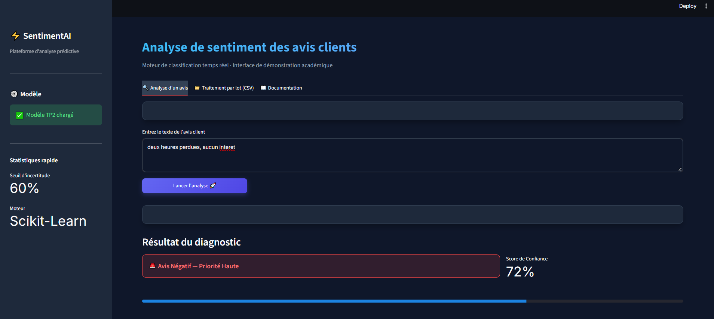

# Semaine 3 — Seuil d'incertitude

## Seuil retenu

Nous conservons le seuil par défaut `SEUIL_INCERTITUDE = 0.60` dans `ui/helpers.py` : en dessous de 60 % de confiance, l'interface n'affiche pas de verdict tranché mais « À vérifier par un agent » en orange.

## Combien d'avis cela envoie à un agent

Sur les 290 avis du jeu de démonstration, l'interface annonce **69 avis à vérifier** (soit environ **23,8 %**), à comparer aux 145 négatifs réels (le modèle en détecte 147). Pour comparaison, le seuil 0,50 n'en envoie aucun à un agent et le seuil 0,75 en envoie 137 (47,2 %). Ce sont principalement des avis mitigés, du type « bon puis mauvais » ou l'inverse, là où le sac de mots hésite parce que les deux moitiés se contredisent.

## Pourquoi ce compromis est juste

Avec un seuil plus bas (0,50), le modèle trancherait seul des cas qu'il ne maîtrise pas et laisserait passer des erreurs coûteuses — un client mécontent classé positif serait traité en retard. Avec un seuil plus haut (0,75), la file humaine se remplirait au point que l'automatisation perdrait tout intérêt. Le seuil de 0,60 nous paraît le bon équilibre : il n'envoie à un agent que les cas réellement douteux, et il rend visible l'hésitation du modèle au lieu de la cacher.

## Aperçu de l'application

### Onglet « Analyse d'un avis » — verdict tranché

L'avis saisi, « deux heures perdues, aucun interet », est clairement négatif. Après clic sur « Lancer l'analyse », la section « Résultat du diagnostic » affiche **« Avis Négatif — Priorité Haute »** avec un **score de confiance de 72 %**, soit au-dessus du seuil de 60 % (affiché dans la barre latérale sous « Seuil d'incertitude »). Le modèle tranche donc seul, sans renvoi vers un agent. La barre de progression sous le résultat reflète ce score.

La barre latérale confirme aussi la configuration utilisée : modèle du TP2 chargé et moteur Scikit-Learn.

